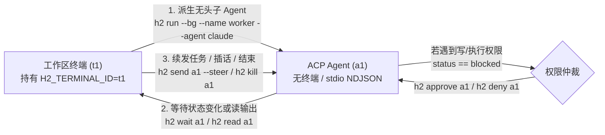

**Herdr2** 是一套采用**“工作区真终端 + 后台无头 ACP 子 Agent”混合双模架构**的 AI 编程工作台与多智能体编排底座，包含：
- **`h2` / `herdr2`（Core 守护进程与 CLI）**：同时管理交互式人类工作区终端（`t1`, `t2`, ...）与后台无头 ACP 子 Agent（`a1`, `a2`, ...）；
- **`Herdr2`（`herdr2` / `herdr2-app` 桌面端）**：基于 GPUI 与 `libghostty-vt` 的原生多 Space/Tab/分屏桌面客户端。

---

## 1. Herdr2 解决什么问题：混合架构设计

原版 Herdr 将人类界面与子 Agent 统统塞进 PTY/ConPTY：当主 Agent 批量派生子 Agent 时，要么弹出一堆终端窗格打扰人，要么只能通过抓终端屏幕字符启发式猜测子 Agent 的运行状态、审批阻塞与完成时机。

**Herdr2 的解法：按职责拆分为两条正交通道**：

| 维度 | 人类工作区终端 (`t1`, `t2`, ...) | 后台被调子 Agent (`a1`, `a2`, ...) |
|---|---|---|
| 启动方式 | `Herdr2` UI（`New space` / `New tab` / `Split` / `+` 菜单 `Terminal` 或 CLI 工具）、`terminal.run` | `h2 run`、内置 MCP 工具 `h2_run`、RPC `agent.run` |
| 底层传输 | 本地 PTY / Windows ConPTY + `holder` 守护 + `libghostty-vt` | **纯无头 ACP（stdio JSON-RPC 2.0 / NDJSON）** |
| 子进程环境 | 完整终端环境（`TERM=xterm-256color`, `COLORTERM=truecolor`, `TERM_PROGRAM=ghostty`, `H2_TERMINAL_ID`） | **无终端环境（`ClientCapabilities { fs: false, terminal: false }`，剥离 `TERM*` 与 `H2_TERMINAL_*`，注入 `H2_AGENT_ID`） |
| 桌面界面表现 | 作为 Space / Tab / Split 窗格直接呈现，支持自由交互输入与快捷键 | **不在桌面打开终端窗格，也不出现在 `terminal.list`** |
| 编排与协作方式 | 人类直接在终端或其运行的 CLI（如 `claude`、`codex`）中工作；CLI 通过 `$H2_TERMINAL_ID` 调用 `h2` 派生/等待子 Agent | 串行 Inbox 队列 + `--steer` 抢占插话 + Core 权限仲裁（`approve-reads`）+ 结构化 Transcript（`h2 read`） |

核心协作闭环：
1. 你在 `Herdr2` 桌面窗口中打开普通 Shell 终端或交互式编程 CLI（均运行于真实 Ghostty/PTY 窗格 `t1` 中）；
2. 当终端里的编程 CLI 需要并发调研或执行子任务时，调用 `h2 run` 或内置 MCP `h2_run` 派生子 Agent `a1`、`a2`...；
3. 子 Agent 全程以纯无头 ACP 模式在后台执行，`h2` 自动将 `parent` 关联到发起终端（如 `t1`），主工作区无多余弹窗，子 Agent 状态变更或阻塞审批会通过 `h2 wait` / `notes` 主动回传给父终端或父 Agent；
4. 关闭桌面窗格 `t1` 时，可通过默认策略自动回收其派生子 Agent（`die_with_parent`，`--outlive-parent` 可保留）。

---

## 2. 与原版 Herdr 零冲突并存布局

Herdr2 与原版 Herdr（`herdr-app` + `hc`）使用完全隔离的可执行文件名、配置目录、状态路径、管道/套接字、环境变量与 Start 菜单入口，可长期同时运行：

| 组件 | 平台 | 原版 Herdr | Herdr2（本项目） |
|---|---|---|---|
| 核心运行时 CLI | Linux / WSL2 | `~/.local/bin/hc`（`herdr-core`） | `~/.local/bin/h2`（`herdr2`） |
| 核心运行时 CLI | Windows | `%LOCALAPPDATA%\Programs\herdr-core\hc.exe` | `%LOCALAPPDATA%\Programs\h2\h2.exe`（含 `herdr2-core.exe` 与 `conpty/`） |
| 核心状态目录 | Linux / Windows | `~/.local/state/herdr-core/` | `~/.local/state/herdr2/` / `%LOCALAPPDATA%\herdr2\` |
| 核心配置与模板 | Linux / Windows | `~/.config/herdr/` | `~/.config/herdr2/` |
| 核心环境变量前缀 | 全平台 | `HC_*`（`HC_AGENT_ID` / `HC_TERMINAL_ID`） | `H2_*`（`H2_AGENT_ID` / `H2_TERMINAL_ID` / `H2_SESSION` / `H2_SOCKET`） |
| 桌面端二进制 | Windows / Linux | `herdr-app.exe` / `herdr-app` | `herdr2.exe`（含 `herdr2-app.exe`） / `herdr2` |
| 桌面端安装目录 | Windows | `%LOCALAPPDATA%\Programs\herdr-app\` | `%LOCALAPPDATA%\Programs\herdr2\` |
| 桌面端配置 Home | Linux / Windows | `~/.config/herdr-app`（`HERDR_APP_HOME`） | `~/.config/herdr2-app`（`HERDR2_APP_HOME`） |
| 控制 Socket / 文档键 | 全平台 | `herdr-app.sock` / `"herdr-app"` | `herdr2-app.sock` / `"herdr2-app"` |
| Windows 窗口与快捷方式 | Windows | `"Herdr"` / `Herdr.lnk` | `"Herdr2"` / `Herdr2.lnk` |

---

## 3. 桌面工作台使用（`Herdr2` GUI 与控制 CLI）

### 3.1 打开终端与交互式 Agent

启动 `herdr2`（Windows 开始菜单点击 **Herdr2**）：

- **新建工作区（Space） / 标签页（Tab） / 分屏（Split）**：默认立即在真实 PTY/ConPTY 中启动本机 Shell（Linux/macOS 默认交互 Shell，Windows 为 `powershell.exe`），由 `libghostty-vt` 渲染与 `holder` 托管；顶部 Tab 栏支持**左右拖拽换序（相邻 Tab 弹簧平移动画）**与滚轮切换，关闭桌面窗口后终端仍在后台存活，重新打开窗口即无缝接回。
- **`+` 菜单（`new-menu`）**：
  - 点击 **`Terminal`**：在当前 Space 打开一个新的真实终端标签页；
  - 点击 **`Start an agent`** 下方已安装工具（源自 `defaults/programs.json`，包含 Claude Code、Codex、OpenCode、Cursor、Copilot、Amp、Antigravity、Kimi、Kiro、Hermes、Qoder、Crush、Gemini、ZCode 等）：直接在真实终端标签页内以完整权限参数启动对应交互式 CLI（如 `claude --dangerously-skip-permissions`、`codex --no-daemon --dangerously-bypass-approvals-and-sandbox`、`agent --yolo --trust`、`opencode --auto`、`gemini --yolo`、`zcode --mode yolo`；Windows 下自动附带 `powershell.exe -ExecutionPolicy Bypass` 确保 `.ps1` / `.cmd` 垫片稳定拉起），可在 `~/.config/herdr2-app/programs.json` 按条目覆写；
  - 点击 **`New space` / `New worktree…` / `Open worktree…`**：新建空间或管理 Git Worktree 空间。
- **左下角 `Agents` 状态面板（双通道实时感知与快捷控制）**：
  - **交互式 CLI Agent（`t*`）**：无需 CLI 发出 Ghostty `OSC 7501`，在工作区终端运行受支持的编程 CLI（包含 `node .../@anthropic-ai/claude-code/cli.js`、版本路径二进制、PowerShell 包装启动以及退出回落到 Shell）均自动识别并实时展示 `working` / `Needs you`（`blocked`） / `done` / `idle`；若程序本身发出 `OSC 7501` 仍以 `OSC 7501` 为最高优先级。
  - **ZCode CLI（`zcode`）**：从菜单启动或在工作区终端手动运行 `zcode` 都能识别（进程名 `zcode-cli`）。首次从 Herdr2 启动时，会把 checkpoint hooks 幂等地写入 ZCode 的运行时配置 `~/.zcode/cli/config.json`，并打开其中的 `hooks.enabled`（hooks 是 ZCode 全部会话共用的开关；在 Herdr2 终端之外这些 hook 立即返回 `{}`，不影响其他 ZCode 会话）。此后每轮对话自动留 checkpoint（`h2 checkpoint ls tN`）。回滚到第 k 轮会恢复工作区文件，并以 `zcode --resume <会话>` 重开同一会话，在下一条提示里注入回滚说明：ZCode 的对话历史存在它自己的数据库里，无法像 Claude Code 那样截断。ZCode 不落盘可读的对话 transcript，所以没有基于 transcript 的会话内容和 handoff 上下文。
  - **无头 ACP Agent（`a*` / `wsl/a*`）**：同时纳入工作区窗格派生的子 Agent（挂在所属父终端树下并向上聚合紧急状态）与独立/跨机无头 ACP 根 Agent（标有 `ACP` 标签）。
  - **点击与移除**：点击窗格 Agent 切换聚焦窗格，点击无头 ACP 行打开 **T3 Code 风格对话弹窗（ACP Peek）**：展示去壳 `<h2 ...>` 后的用户消息气泡（含来源徽章与时间）、可折叠推理与工具执行时间线（Thought / Tool Calls / Plan）、富文本 Markdown 排版（表格、列表、带语言顶栏与一键 `Copy` 的代码块卡片、Turn 全文复制与诊断 `stderr` 抽屉）、行内权限定向审批条（`Approve` / `Deny`），以及底部自增高多行输入栏（`Enter` 发送、`Shift+Enter` 换行、`Steer` 抢占插话与队列计数）；悬停任意父行或子行均提供 **`✕` 移除按钮**（关闭窗格或结束 ACP 会话并同步退场）；关闭某个 Space（`space.close`）时会自动结束并同步清理归属该工作区目录的无头 ACP 会话。
  - **手动校准状态（`Idle` / `Working` / `Needs you` / `Done` / `Auto detect`）**：当终端 Agent 识别偏差或需要手动标记状态时，可**点击左下角 Agents 列表中任意 Agent / 子 Agent 左侧的状态圆点/徽标**、**右键点击任意 Agent 行**、通过命令面板（`Ctrl+Shift+P` 搜索 `Set agent status`）或执行 `herdr2 do agent.status` 手动设置状态，并通过 `herdr.status` 标签跨端持久化；新的一轮对话开始或切回 `Auto detect` 时自动恢复自动识别。
- 窗口中每个终端子进程都自动注入了环境变量 `H2_TERMINAL_ID`（如 `t1`）和 `H2_TERMINAL_SOCKET`，因此直接在终端里运行 `h2` 命令即可自动识别当前父终端地址。

### 3.2 `herdr2` 窗口控制命令

可通过 `herdr2` CLI 或脚本远程编排已打开的 `Herdr2` 桌面窗口：

```sh
herdr2 ls                     # 列出当前窗口的 spaces、tabs、panes (t*) 与无头 headless_agents (a*)
herdr2 status                 # 查看当前焦点、布局、缩放与 mod 加载错误
herdr2 commands               # 列出全部窗口命令（无需窗口已启动）
herdr2 --skill                # 打印面向 AI Agent 的桌面控制手册

# 远程驱动窗口动作
herdr2 do space.new --name api --folder ~/repo/api
herdr2 do tab.new --name "shell"
herdr2 do tab.new --name "Claude Code" --argv '["claude", "--dangerously-skip-permissions"]'
herdr2 do pane.split --direction right
herdr2 do terminal.peek --terminal wsl/a6   # 弹出交互式 ACP 对话与审批面板
herdr2 do agent.status --terminal wsl/t13 --status idle   # 手动覆盖 Agent 状态（--status auto 恢复自动识别）
herdr2 do app.language --language zh-CN                 # 实时切换桌面界面语言（"en" 英文 / "zh-CN" 简体中文）
herdr2 do terminal.scroll --lines -20
herdr2 shot /tmp/herdr2.png   # 截取当前 GPUI 窗口渲染帧
```

### 3.3 界面语言设置（English / 简体中文）

桌面端支持实时切换英文与简体中文界面：
- **设置面板**：点击左下角 **Settings / 设置** → **Look / 外观** → **Interface language / 界面语言** 选择 `English` 或 `简体中文`（无需重启，所有侧栏、标签页、弹窗与右键菜单立即切换）；
- **命令面板 / 右键菜单 / CLI**：按 `Ctrl+Shift+P` 搜索 `Language: 简体中文` 或 `Language: English`、右键桌面空白处切换，或运行 `herdr2 do app.language --language zh-CN`。

---

## 4. `h2` CLI 核心工作流（无头 ACP 子 Agent 与混合终端控制）



### 4.1 检查守护进程与状态

```sh
h2 --version
h2 server status
h2 server restart   # 重启守护进程时保留 kept 的终端 holder 与 --keep ACP 会话

h2 ls               # 混合树状视图：分别展示 live 的 ACP Agents (a*) 与 Terminals (t*)
h2 ls --all --json  # JSON 格式，包含已结束条目与远端机器状态
h2 events           # 实时订阅生命周期与结构化 transcript / status 事件流（NDJSON）
```

### 4.2 派生无头 ACP 子 Agent（`h2 run`）

内置 `13` 个 `--agent` 预设名（覆盖 12 种 ACP Adapter，其中 `cursor` 与 `cursor-agent` 均映射到 `cursor-agent acp`）：

- `claude`（`claude-agent-acp`）
- `codex`（`codex-acp`）
- `gemini`（`gemini --acp`）
- `opencode`（`opencode acp`）
- `copilot`（`copilot --acp --stdio`）
- `cursor` / `cursor-agent`（`cursor-agent acp`）
- `kimi`（`kimi acp`）
- `qwen`（`qwen --acp`）
- `pi`（`pi-acp`）
- `hermes`（`hermes-acp`）
- `glm`（`glm-acp-agent`）
- `zcode`（`zcode-acp-server`）

```sh
# 1) 前台运行并等待首轮完成（不打开任何终端窗格）
h2 run --agent claude --cwd /path/to/repo --prompt "只分析 Cargo.toml 依赖问题，不要改文件"

# 2) 后台启动并发起任务（推荐用于多 Agent 编排）
h2 run --bg --name reviewer --cwd /path/to/repo --agent codex \
  --prompt "审查 src/main.rs 的错误处理并发回总结"

# 3) 使用自定义无终端 ACP 适配命令
h2 run --bg --name custom -- python3 ./my_acp_agent.py

# 4) 从 ~/.config/herdr2/templates/*.md 模板启动
h2 templates
h2 run --bg --name audit security-review "重点检查 auth 模块"
```

常用运行参数：

- `--model <MODEL>`：通过 `session/set_config_option`（不支持时回退 `session/set_model`）指定模型；
- `--mode <MODE>`：切换 ACP 会话模式（如只读/规划/执行）；
- `--system-prompt <TEXT>`：附加系统级提示词；
- `--permissions <approve-all|approve-reads|deny-all|ask|dangerously-skip-permissions>`：覆盖当前会话权限策略（`dangerously-skip-permissions` / `bypassPermissions` 等价于 `approve-all`）；
- `--dangerously-skip-permissions`：同时设置策略为 `approve-all` 并在支持时自动切换到 ACP `bypassPermissions` 模式（Claude ACP 对话框中显示为 **`dangerously-skip-permissions`**）；
- `--no-mcp`：禁用自动注入内置 `herdr2` MCP（`h2 mcp`）；
- `--keep`：标记持久保留，Daemon 重启或异常恢复时优先尝试 ACP `session/load`；
- `--outlive-parent`：父节点结束时不随父级联动清理；
- `--rm`：运行结束后自动移除记录；
- `--on <machine>`：在已配对的远端机器上运行。

### 4.3 对 ACP Agent 进行队列发送、插话（Steer）与权限审批

```sh
# 队列发送：追加到串行收件箱尾部，当前轮完成后按序执行
h2 send reviewer "顺便检查 tests/ 下是否缺少断言"

# 抢占插话 (--steer)：发送 ACP session/cancel 中断当前轮，并插队到队首立即执行
h2 send reviewer --steer "停下！需求变更为保留旧接口兼容性"

# 查看对话与详细状态
h2 read reviewer                # 完整结构化对话文本
h2 read reviewer --last         # 仅最新一轮最终回复
h2 read reviewer --lines 50     # 最近 50 行
h2 get reviewer                 # 状态、轮次、queued_count 与 pending_permission

# 权限审批（当 status 为 blocked 时）
h2 approve reviewer
h2 approve reviewer --option allow_once
h2 deny reviewer

# 打断、持久、配置与挂载
h2 interrupt reviewer
h2 config reviewer --id model --value gpt-5.4             # 运行中切换模型或自定义模型 ID
h2 config reviewer --id reasoning_effort --value high      # 调整思考强度 (thought_level)
h2 config reviewer --id fast-mode --bool true              # 开启/关闭 Fast 模式
h2 config reviewer --id mode --value dangerously-skip-permissions  # Claude ACP 一键切至免审批并同步放行挂起请求
h2 keep reviewer
h2 label reviewer role=backend
h2 kill reviewer
h2 rm reviewer
```

桌面交互界面（`Agents` 面板点击无头 ACP Agent 或使用 `herdr2 do`）也支持两项扩展操作：
- **底部模型能力栏**：在输入框下方直接切换 **Model**（支持搜索过滤与输入自定义模型 ID）、**Reasoning**（思考强度）、**Fast**（开关切换）、**Mode**（权限/预设模式）及 `Collaboration mode`，底层实时下发 `agent.config`。
- **挂载为工作区 Tab / 左右上下分屏 / 退回后台**：
  - 点击对话右上角 **`↗ Open as Tab`**（或执行 `herdr2 do terminal.keep --terminal wsl/a6 --place tab`）可将当前 ACP Agent 挂载为独立工作区 Tab；点击 **`Split right`**、在左下角 `Agents` 行右键菜单或执行 `herdr2 do terminal.keep --terminal wsl/a6 --place right` / `--place down`，即可把 ACP Agent 左右或上下分屏进当前 Tab（已挂载的 ACP 也可从该分屏与普通终端互分或重排）。
  - 挂载到 Tab 或分屏内时，顶部仅保留一层统一的轻量窗格栏（含图标、名称、`ACP` 徽章、路径、状态、进行中 **`Stop`** 与悬停拆分/缩放/移回后台按钮），避免双层标题栏重复信息；点击 Tab 或窗格右上角 **`x`** 关闭按钮默认仅将 ACP Agent **移回后台继续运行**（不杀进程；显式结束请用右键菜单 `Kill` 或 `h2 kill`）。
  - 若已挂载在 Tab 中的 ACP 会话在外部被结束（例如父智能体完成任务后执行 `h2 kill`），该标签页不会突然消失，而是切换为只读 **`Ended` / `已结束`** 状态并完整保留对话记录，供随时翻阅与复制，直到手动点击 `×` 关闭标签页。

### 4.4 对工作区 PTY 终端 (`t*`) 的命令行操作

除图形界面外，`h2` CLI 同样支持读取、发送输入、挂载或清理真实 PTY 终端：

```sh
h2 read t1 --lines 40           # 读取 t1 当前终端屏幕与滚动历史纯文本
h2 send t1 "cargo test --locked" # 向 t1 终端粘贴文本并在静默期后回车（兼容编辑器/Shell）
h2 keys t1 ctrl+c               # 向 t1 发送按键序列（enter / esc / ctrl+c 等）
h2 attach t1                    # 在当前终端实时接管 t1 会话（Ctrl-\ d 脱离）
h2 interrupt t1                 # 发送终端中断控制
h2 put t1 ./artifact.png        # 把本地文件复制到目标所在路径并打印远程路径
h2 kill t1 && h2 rm t1          # 结束并清理已退出的终端记录
```

---

## 5. 内置 MCP 自举编排与跨机联邦

### 5.1 自动注入的 `h2 mcp` 工具集

默认配置下（`inject_mcp = true`），`h2` 在启动 ACP 会话时自动注入 stdio MCP 服务（`command: <herdr2>, args: ["mcp"]`, 携带 `H2_AGENT_ID` 与 `H2_AGENT_SOCKET`）。如果交互式编程 CLI 运行在工作区终端 `t*` 内，显式将其注册为 MCP Server 时 `h2 mcp` 也会自动通过 `H2_TERMINAL_ID` 识别当前工作区终端为父节点（`client::agent_id().or_else(client::terminal_id)`）。

暴露的 7 个 MCP 工具：

| MCP 工具名 | 作用 | 等价 CLI |
|---|---|---|
| `h2_run` | 派生无头 ACP 子 Agent（支持 `agent` / `prompt` / `cwd` / `name` / `wait` / `permissions` / `model` 等） | `h2 run` |
| `h2_send` | 向指定 Agent 或终端发送消息（`agent` 目标支持 `steer` 抢占） | `h2 send` |
| `h2_wait` | 等待目标 Agent/终端或当前节点下子代状态变化（`children: "any" \| "all"`） | `h2 wait` |
| `h2_read` | 读取 Agent 结构化回答（`last: true`）或终端屏幕输出 | `h2 read` |
| `h2_ls` | 列出当前活跃/历史 Agents 与 Terminals 列表 | `h2 ls` |
| `h2_approve` | 批准处于 `blocked` 状态的子 Agent 权限请求 | `h2 approve` |
| `h2_deny` | 拒绝处于 `blocked` 状态的子 Agent 权限请求 | `h2 deny` |

当 `notes` 开启时：
- Agent 间通信自动包裹 `<h2 from="...">...</h2>` 信封避免身份混淆；
- 子代进入 `blocked`、`error` 或退出时，Core 异步将通知投递回父 Agent 收件箱（或静默后写入父 PTY 终端）；
- 父级处于活跃终端输入草稿期或有待审批阻塞时，自动遵循 `notes_quiet` / `draft_wait` 策略避免打断用户输入。

### 5.2 非 Agent 工具与跨机 SSH 联邦

```sh
# 1) 直接执行单次命令（走直连子进程捕获精确 stdout/stderr 与退出码）
h2 exec --cwd /repo -- cargo test --locked

# 2) 文件原子读写与精准替换
h2 file read src/main.rs --offset 1 --limit 80
echo "hello" | h2 file write /tmp/note.txt
h2 file edit src/config.toml --old 'ask' --new 'approve-reads'

# 3) 跨机器 SSH 联邦（例如 Windows Herdr2 连接本机 WSL 或远端 Linux）
h2 machine add zzh@gpu-server --name gpu
h2 run --on gpu --bg --name trainer --agent claude --prompt "跑一轮基线评估"
h2 ls                           # 统一视图展示 wsl/t1、gpu/trainer 等
h2 send gpu/trainer "检查显存"
```

---

## 6. 配置文件参考

### 6.1 Core 运行时配置 `~/.config/herdr2/config.toml`

```toml
# ACP 子 Agent 默认权限策略: approve-reads (默认) | approve-all | deny-all | ask
default_permissions = "approve-reads"

# 是否向 ACP 会话自动注入内置 `h2 mcp` 服务（默认 true）
inject_mcp = true

# 父子状态通知与 <h2> 信封开关（默认 true）
notes = true

# PTY 终端父级投递静默延迟秒数（默认 3）与草稿避让秒数（默认 60）
notes_quiet = 3.0
draft_wait = 60.0

# `h2 wait` 默认单次检查超时秒数（默认 180）
wait_timeout = 180.0

# `h2` 守护监听套接字路径（默认位于 $XDG_RUNTIME_DIR/herdr2/）
# socket = "/custom/path/herdr2.sock"

# 覆盖交互式工作区默认 Shell
# shell = ["/bin/zsh"]

# 覆盖或新增自定义 ACP Agent 预设命令
[agents]
claude = ["claude-agent-acp"]
my-local-agent = ["python3", "/opt/agents/my_acp.py", "--stdio"]
```

### 6.2 桌面端配置 `~/.config/herdr2-app/settings.json`

`Herdr2` 桌面设置由界面与配置共同维护（修改自动热重载）：

```json
{
  "language": "zh-CN",
  "zoom": 1.2,
  "font_ligatures": false,
  "terminal_line_height": 1.0,
  "terminal_cell_width": 1.0,
  "terminal_scroll_speed": 1.0,
  "minimum_contrast": 1.0,
  "telemetry": false,
  "sounds": {
    "enabled": true
  }
}
```
