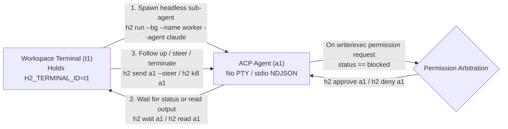

**Herdr2** is an AI coding workbench and multi-agent orchestration runtime built on a **hybrid dual-plane architecture ("real workspace terminals + headless background ACP sub-agents")**, consisting of:
- **`h2` / `herdr2` (Core daemon & CLI)**: Manages both interactive human workspace terminals (`t1`, `t2`, ...) and background headless ACP sub-agents (`a1`, `a2`, ...).
- **`Herdr2` (`herdr2` / `herdr2-app` desktop client)**: A native multi-Space, Tab, and Split-pane desktop client powered by GPUI and `libghostty-vt`.

---

## 1. What Problem Herdr2 Solves: Hybrid Architecture Design

Original Herdr placed both human workspaces and spawned sub-agents inside PTY/ConPTY sessions: whenever a primary agent fanned out sub-agents, it either flooded the UI with extra terminal panes or had to scrape terminal screen characters heuristically to guess sub-agent progress, permission blocks, and completion.

**Herdr2's solution splits responsibilities into two orthogonal planes**:

| Dimension | Human Workspace Terminal (`t1`, `t2`, ...) | Background Sub-Agent (`a1`, `a2`, ...) |
|---|---|---|
| Launch mechanism | `Herdr2` UI (`New space` / `New tab` / `Split` / `+` menu `Terminal` or CLI tools), `terminal.run` | `h2 run`, built-in MCP tool `h2_run`, RPC `agent.run` |
| Underlying transport | Local PTY / Windows ConPTY + `holder` daemon + `libghostty-vt` | **Pure headless ACP (stdio JSON-RPC 2.0 / NDJSON)** |
| Child environment | Full terminal environment (`TERM=xterm-256color`, `COLORTERM=truecolor`, `TERM_PROGRAM=ghostty`, `H2_TERMINAL_ID`) | **Terminal-free environment** (`ClientCapabilities { fs: false, terminal: false }`, strips `TERM*` and `H2_TERMINAL_*`, injects `H2_AGENT_ID`) |
| Desktop presentation | Displayed directly as Space / Tab / Split panes with full interactive input and shortcuts | **Never opens a terminal pane on desktop and never appears in `terminal.list`** |
| Orchestration & collaboration | Humans work directly in shells or CLIs (such as `claude`, `codex`); CLIs use `$H2_TERMINAL_ID` to spawn/wait on sub-agents via `h2` | Serial inbox queue + `--steer` preemption + Core permission arbitration (`approve-reads`) + structured transcript (`h2 read`) |

Core collaboration loop:
1. You open a standard shell or interactive coding CLI in a `Herdr2` desktop window (running inside a real Ghostty/PTY pane `t1`).
2. When the coding CLI needs parallel research or sub-task execution, it invokes `h2 run` or the built-in `h2_run` MCP tool to spawn sub-agents `a1`, `a2`, ...
3. Sub-agents execute purely in headless ACP mode in the background; `h2` automatically binds `parent` to the originating terminal (`t1`), keeping your workspace free of unwanted popups, while status updates and permission blocks flow back to the parent via `h2 wait` / `notes`.
4. Closing desktop pane `t1` automatically cleans up its spawned sub-agents under the default `die_with_parent` policy (use `--outlive-parent` to keep them alive).

---

## 2. Zero-Conflict Coexistence Layout with Original Herdr

Herdr2 and original Herdr (`herdr-app` + `hc`) use completely isolated executable names, config directories, state paths, sockets/pipes, environment variables, and Start Menu entries so both can run side by side indefinitely:

| Component | Platform | Original Herdr | Herdr2 (This Project) |
|---|---|---|---|
| Core runtime CLI | Linux / WSL2 | `~/.local/bin/hc` (`herdr-core`) | `~/.local/bin/h2` (`herdr2`) |
| Core runtime CLI | Windows | `%LOCALAPPDATA%\Programs\herdr-core\hc.exe` | `%LOCALAPPDATA%\Programs\h2\h2.exe` (with `herdr2-core.exe` & `conpty/`) |
| Core state directory | Linux / Windows | `~/.local/state/herdr-core/` | `~/.local/state/herdr2/` / `%LOCALAPPDATA%\herdr2\` |
| Core config & templates | Linux / Windows | `~/.config/herdr/` | `~/.config/herdr2/` |
| Core env var prefix | All platforms | `HC_*` (`HC_AGENT_ID` / `HC_TERMINAL_ID`) | `H2_*` (`H2_AGENT_ID` / `H2_TERMINAL_ID` / `H2_SESSION` / `H2_SOCKET`) |
| Desktop binary | Windows / Linux | `herdr-app.exe` / `herdr-app` | `herdr2.exe` (with `herdr2-app.exe`) / `herdr2` |
| Desktop install directory | Windows | `%LOCALAPPDATA%\Programs\herdr-app\` | `%LOCALAPPDATA%\Programs\herdr2\` |
| Desktop config home | Linux / Windows | `~/.config/herdr-app` (`HERDR_APP_HOME`) | `~/.config/herdr2-app` (`HERDR2_APP_HOME`) |
| Control socket / doc key | All platforms | `herdr-app.sock` / `"herdr-app"` | `herdr2-app.sock` / `"herdr2-app"` |
| Windows title & shortcut | Windows | `"Herdr"` / `Herdr.lnk` | `"Herdr2"` / `Herdr2.lnk` |

---

## 3. Desktop Workbench (`Herdr2` GUI & Control CLI)

### 3.1 Opening Terminals and Interactive Agents

Launch `herdr2` (or click **Herdr2** in the Windows Start Menu):

- **New Space / New Tab / Split Pane**: Immediately starts your local shell in a real PTY/ConPTY (default interactive shell on Linux/macOS, `powershell.exe` on Windows), rendered by `libghostty-vt` and managed by `holder`. The top tab bar supports **horizontal drag reordering (with spring animations for neighboring tabs)** and scroll-wheel tab switching. Closing the desktop window leaves terminals running in the background; reopening reattaches seamlessly.
- **`+` Menu (`new-menu`)**:
  - **`Terminal`**: Opens a new real terminal tab in the current Space.
  - **`Start an agent`**: Lists detected local coding tools (from `defaults/programs.json`, including Claude Code, Codex, OpenCode, Cursor, Copilot, Amp, Antigravity, Kimi, Kiro, Hermes, Qoder, Crush, Gemini, ZCode, etc.) and launches them inside a real terminal tab with full-permission flags (e.g., `claude --dangerously-skip-permissions`, `codex --no-daemon --dangerously-bypass-approvals-and-sandbox`, `agent --yolo --trust`, `opencode --auto`, `gemini --yolo`, `zcode --mode yolo`; on Windows, automatically wraps with `powershell.exe -ExecutionPolicy Bypass` so `.ps1`/`.cmd` shims launch reliably). Individual entries can be overridden in `~/.config/herdr2-app/programs.json`.
  - **`New space` / `New worktree…` / `Open worktree…`**: Creates a workspace or manages Git worktree spaces.
- **Bottom-Left `Agents` Status Panel (Dual-Channel Live Awareness & Quick Controls)**:
  - **Interactive CLI Agents (`t*`)**: Even without Ghostty `OSC 7501`, supported coding CLIs running inside workspace terminals (including `node .../@anthropic-ai/claude-code/cli.js`, versioned binaries, PowerShell-wrapped launches, and returning to the shell on exit) are automatically detected and tracked across `working` / `Needs you` (`blocked`) / `done` / `idle`. When a program emits `OSC 7501`, `OSC 7501` still takes top priority.
  - **ZCode CLI (`zcode`)**: Detected whether started from the menu or typed manually in a workspace terminal (process name `zcode-cli`). On first launch from Herdr2, checkpoint hooks are idempotently written to ZCode's runtime config `~/.zcode/cli/config.json` and `hooks.enabled` is turned on (a shared switch across ZCode sessions; outside Herdr2 terminals the hooks immediately return `{}` with no side effects). Each turn then records a checkpoint (`h2 checkpoint ls tN`). Rolling back to turn *k* restores workspace files, restarts the session with `zcode --resume <session>`, and injects a rollback note into the next prompt—because ZCode stores conversation history in its own database rather than truncatable files and does not persist a readable transcript, transcript-based content reading and handoff context are unavailable for ZCode.
  - **Headless ACP Agents (`a*` / `wsl/a*`)**: Displays both sub-agents spawned by workspace panes (nested under their parent terminal with upward urgent-status aggregation) and standalone or cross-machine root ACP agents (tagged `ACP`).
  - **Click and Remove**: Clicking a pane agent focuses its pane; clicking a headless ACP row opens the **T3 Code-style conversation overlay (ACP Peek)** showing unwrapped `<h2 ...>` user message bubbles (with source badges and timestamps), collapsible reasoning and tool-execution timelines (Thought / Tool Calls / Plan), rich Markdown rendering (tables, lists, code-block cards with language headers and one-click `Copy`, full-turn copy, and diagnostic `stderr` drawer), inline permission approval bars (`Approve` / `Deny`), and an auto-expanding multiline composer (`Enter` to send, `Shift+Enter` for newline, `Steer` preemption, and queue count). Hovering any parent or child row reveals an **`✕` remove button** (closing the pane or terminating the ACP session cleanly). Closing a Space (`space.close`) automatically terminates and cleans up headless ACP sessions belonging to that workspace directory.
  - **Manual Status Override (`Idle` / `Working` / `Needs you` / `Done` / `Auto detect`)**: If terminal state inference misfires or you want to mark status explicitly, click the **status dot/badge on the left of any agent or sub-agent row**, **right-click any agent row**, open the Command Palette (`Ctrl+Shift+P` → `Set agent status`), or run `herdr2 do agent.status`. Overrides persist across clients via the `herdr.status` label and revert to automatic detection when a new turn begins or you select `Auto detect`.
- Every terminal child process inside the window automatically receives `H2_TERMINAL_ID` (e.g., `t1`) and `H2_TERMINAL_SOCKET`, so running `h2` commands directly inside any terminal automatically knows its parent terminal address.

### 3.2 `herdr2` Window Control CLI

Script or remotely control an open `Herdr2` desktop window using the `herdr2` CLI:

```sh
herdr2 ls                     # List spaces, tabs, panes (t*), and headless_agents (a*) in the window
herdr2 status                 # Show current focus, layout, zoom level, and mod load errors
herdr2 commands               # List all window commands (works without a running window)
herdr2 --skill                # Print the desktop control manual for AI agents

# Drive window actions remotely
herdr2 do space.new --name api --folder ~/repo/api
herdr2 do tab.new --name "shell"
herdr2 do tab.new --name "Claude Code" --argv '["claude", "--dangerously-skip-permissions"]'
herdr2 do pane.split --direction right
herdr2 do terminal.peek --terminal wsl/a6   # Open the interactive ACP conversation & approval panel
herdr2 do agent.status --terminal wsl/t13 --status idle   # Manually override agent status (--status auto restores auto-detect)
herdr2 do app.language --language zh-CN                   # Switch UI language live ("en" / "zh-CN")
herdr2 do terminal.scroll --lines -20
herdr2 shot /tmp/herdr2.png   # Capture a screenshot of the current GPUI window frame
```

### 3.3 Interface Language Settings (English / 简体中文)

The desktop client supports live switching between English and Simplified Chinese:
- **Settings Panel**: Open bottom-left **Settings** → **Look** → **Interface language** and choose `English` or `简体中文` (all sidebars, tabs, modals, and context menus update immediately with no restart).
- **Command Palette / Context Menu / CLI**: Press `Ctrl+Shift+P` and search `Language: 简体中文` or `Language: English`, right-click empty desktop space, or run `herdr2 do app.language --language zh-CN`.

---

## 4. Core `h2` CLI Workflows (Headless ACP Sub-Agents & Hybrid Terminal Control)



### 4.1 Checking the Daemon and Runtime State

```sh
h2 --version
h2 server status
h2 server restart   # Preserves kept terminal holders and --keep ACP sessions across restarts

h2 ls               # Hybrid tree view showing live ACP Agents (a*) and Terminals (t*)
h2 ls --all --json  # JSON output including finished entries and remote machine states
h2 events           # Follow lifecycle and structured transcript/status events in real time (NDJSON)
```

### 4.2 Spawning Headless ACP Sub-Agents (`h2 run`)

Built-in `--agent` presets include 13 preset names covering 12 ACP adapters (both `cursor` and `cursor-agent` map to `cursor-agent acp`):

- `claude` (`claude-agent-acp`)
- `codex` (`codex-acp`)
- `gemini` (`gemini --acp`)
- `opencode` (`opencode acp`)
- `copilot` (`copilot --acp --stdio`)
- `cursor` / `cursor-agent` (`cursor-agent acp`)
- `kimi` (`kimi acp`)
- `qwen` (`qwen --acp`)
- `pi` (`pi-acp`)
- `hermes` (`hermes-acp`)
- `glm` (`glm-acp-agent`)
- `zcode` (`zcode-acp-server`)

```sh
# 1) Run in foreground and wait for the first turn (opens no terminal pane)
h2 run --agent claude --cwd /path/to/repo --prompt "Analyze Cargo.toml dependency issues without editing files"

# 2) Start in the background (recommended for multi-agent orchestration)
h2 run --bg --name reviewer --cwd /path/to/repo --agent codex \
  --prompt "Review error handling in src/main.rs and return a summary"

# 3) Run a custom terminal-free ACP adapter command
h2 run --bg --name custom -- python3 ./my_acp_agent.py

# 4) Launch from ~/.config/herdr2/templates/*.md templates
h2 templates
h2 run --bg --name audit security-review "Focus on the auth module"
```

Common run flags:

- `--model <MODEL>`: Selects the model via `session/set_config_option` (falling back to `session/set_model`).
- `--mode <MODE>`: Switches the ACP session mode (e.g., read-only, plan, execute).
- `--system-prompt <TEXT>`: Appends a system-level prompt.
- `--permissions <approve-all|approve-reads|deny-all|ask|dangerously-skip-permissions>`: Overrides the session permission policy (`dangerously-skip-permissions` / `bypassPermissions` is equivalent to `approve-all`).
- `--dangerously-skip-permissions`: Sets the policy to `approve-all` and automatically switches to ACP `bypassPermissions` mode when supported (displayed in Claude ACP dialogs as **`dangerously-skip-permissions`**).
- `--no-mcp`: Disables automatic injection of the built-in `herdr2` MCP server (`h2 mcp`).
- `--keep`: Marks the agent as persistent so Core attempts ACP `session/load` recovery after daemon restarts or crashes.
- `--outlive-parent`: Prevents automatic cleanup when the parent node exits.
- `--rm`: Automatically removes the record once the agent finishes.
- `--on <machine>`: Runs the agent on a paired remote machine.

### 4.3 Queued Sending, Preemptive Steering (`--steer`), and Permission Approvals

```sh
# Queue a follow-up prompt at the tail of the serial inbox (runs after the active turn finishes)
h2 send reviewer "Also check whether tests/ is missing assertions"

# Preemptive steer (--steer): sends ACP session/cancel to stop the active turn and delivers next
h2 send reviewer --steer "Stop! Requirements changed—keep backwards compatibility with the legacy API"

# Inspect transcript and detailed status
h2 read reviewer                # Full structured conversation transcript
h2 read reviewer --last         # Only the final assistant reply from the latest turn
h2 read reviewer --lines 50     # Last 50 rendered lines
h2 get reviewer                 # Status, turn count, queued_count, and pending_permission

# Permission arbitration (when status == blocked)
h2 approve reviewer
h2 approve reviewer --option allow_once
h2 deny reviewer

# Interrupt, persist, live-configure, and clean up
h2 interrupt reviewer
h2 config reviewer --id model --value gpt-5.4             # Switch model or custom model ID live
h2 config reviewer --id reasoning_effort --value high      # Adjust reasoning effort (thought_level)
h2 config reviewer --id fast-mode --bool true              # Toggle Fast mode
h2 config reviewer --id mode --value dangerously-skip-permissions  # Switch Claude ACP to bypass mode and release pending request
h2 keep reviewer
h2 label reviewer role=backend
h2 kill reviewer
h2 rm reviewer
```

The desktop UI (clicking a headless ACP agent in the `Agents` sidebar or driving it via `herdr2 do`) also supports two extended controls:
- **Bottom Model Capability Strip**: Directly beneath the composer input, switch **Model** (with search filtering and custom model ID entry), **Reasoning** (effort level), **Fast** (toggle), **Mode** (permission/preset mode), and `Collaboration mode`, all dispatched live via `agent.config`.
- **Mount as Workspace Tab / Split Left-Right or Top-Bottom / Detach to Background**:
  - Click **`↗ Open as Tab`** in the top-right corner of the overlay (or run `herdr2 do terminal.keep --terminal wsl/a6 --place tab`) to mount the ACP agent as a standalone workspace tab. Click **`Split right`**, use the `Agents` row context menu, or run `herdr2 do terminal.keep --terminal wsl/a6 --place right` / `--place down` to split the ACP agent alongside panes in the current tab (mounted ACP panes can also split and rearrange alongside regular terminals).
  - When mounted in a tab or split, only a single unified lightweight pane bar is shown at the top (icon, name, `ACP` badge, path, status, active **`Stop`**, and hover split/zoom/background buttons), avoiding duplicate title bars. Clicking **`x`** on a mounted ACP tab or pane **detaches it back to the background** by default without killing the process (to terminate explicitly, use the context menu's `Kill` or `h2 kill`).
  - If a mounted ACP session terminates externally (for example, after a parent agent finishes and runs `h2 kill`), its tab stays open in a read-only **`Ended`** state preserving the full conversation for reading and copying until you close the tab manually with `×`.

### 4.4 Controlling Workspace PTY Terminals (`t*`) from the CLI

In addition to the GUI, the `h2` CLI can read, send input to, attach to, or clean up real PTY terminals:

```sh
h2 read t1 --lines 40            # Read plaintext screen and scrollback history of t1
h2 send t1 "cargo test --locked" # Paste text into t1 and press Enter after a quiet window (editor/shell safe)
h2 keys t1 ctrl+c                # Send named key sequences (enter / esc / ctrl+c, etc.) to t1
h2 attach t1                     # Attach live to t1 in your shell (Ctrl-\ then d to detach)
h2 interrupt t1                  # Send terminal interrupt control
h2 put t1 ./artifact.png         # Stage a local file next to the target and print the remote path
h2 kill t1 && h2 rm t1           # Terminate and remove a finished terminal record
```

---

## 5. Built-In MCP Self-Orchestration and Cross-Machine Federation

### 5.1 Auto-Injected `h2 mcp` Toolset

By default (`inject_mcp = true`), `h2` injects its stdio MCP server (`command: <herdr2>, args: ["mcp"]`, carrying `H2_AGENT_ID` and `H2_AGENT_SOCKET`) into every ACP session. When an interactive coding CLI running inside workspace terminal `t*` registers `h2 mcp` explicitly as an MCP server, `h2 mcp` automatically detects the parent terminal via `H2_TERMINAL_ID` (`client::agent_id().or_else(client::terminal_id)`).

Exposed 7 MCP tools:

| MCP Tool Name | Purpose | Equivalent CLI |
|---|---|---|
| `h2_run` | Spawn a headless ACP sub-agent (supports `agent` / `prompt` / `cwd` / `name` / `wait` / `permissions` / `model`, etc.) | `h2 run` |
| `h2_send` | Send a message to a target agent or terminal (`agent` targets support `steer` preemption) | `h2 send` |
| `h2_wait` | Wait for a target agent/terminal or children of the current node (`children: "any" \| "all"`) | `h2 wait` |
| `h2_read` | Read structured agent output (`last: true`) or terminal screen text | `h2 read` |
| `h2_ls` | List active/finished Agents and Terminals | `h2 ls` |
| `h2_approve` | Approve a pending permission request on a `blocked` sub-agent | `h2 approve` |
| `h2_deny` | Deny a pending permission request on a `blocked` sub-agent | `h2 deny` |

When `notes` is enabled:
- Inter-agent messages are automatically wrapped in `<h2 from="...">...</h2>` envelopes to prevent identity confusion.
- When a child transitions to `blocked`, `error`, or exits, Core asynchronously delivers a notification to the parent agent's inbox (or pastes it into the parent PTY terminal after the quiet period).
- If the parent terminal has an active input draft or a pending approval block, `notes_quiet` / `draft_wait` backoff prevents interrupting user typing.

### 5.2 Non-Agent Utilities and Cross-Machine SSH Federation

```sh
# 1) Run a one-shot non-agent command directly (captures exact stdout/stderr and exit code)
h2 exec --cwd /repo -- cargo test --locked

# 2) Atomic file read, write, and exact text replacement
h2 file read src/main.rs --offset 1 --limit 80
echo "hello" | h2 file write /tmp/note.txt
h2 file edit src/config.toml --old 'ask' --new 'approve-reads'

# 3) Cross-machine SSH federation (e.g., Windows Herdr2 connecting to local WSL or remote Linux)
h2 machine add zzh@gpu-server --name gpu
h2 run --on gpu --bg --name trainer --agent claude --prompt "Run a baseline evaluation"
h2 ls                           # Unified view showing wsl/t1, gpu/trainer, etc.
h2 send gpu/trainer "Check GPU memory usage"
```

---

## 6. Configuration File Reference

### 6.1 Core Runtime Config `~/.config/herdr2/config.toml`

```toml
# Default permission policy for ACP sub-agents: approve-reads (default) | approve-all | deny-all | ask
default_permissions = "approve-reads"

# Automatically inject the built-in `h2 mcp` server into ACP sessions (default: true)
inject_mcp = true

# Enable parent-child status notifications and <h2> envelopes (default: true)
notes = true

# Quiet delay before pasting into a parent PTY (default: 3s) and draft backoff (default: 60s)
notes_quiet = 3.0
draft_wait = 60.0

# Default single check-in timeout for `h2 wait` in seconds (default: 180)
wait_timeout = 180.0

# Custom `h2` daemon socket path (defaults to $XDG_RUNTIME_DIR/herdr2/)
# socket = "/custom/path/herdr2.sock"

# Override the default shell for interactive workspace terminals
# shell = ["/bin/zsh"]

# Override or add custom ACP agent preset commands
[agents]
claude = ["claude-agent-acp"]
my-local-agent = ["python3", "/opt/agents/my_acp.py", "--stdio"]
```

### 6.2 Desktop Client Config `~/.config/herdr2-app/settings.json`

`Herdr2` desktop settings are kept in sync between the UI and config file (changes hot-reload automatically):

```json
{
  "language": "zh-CN",
  "zoom": 1.2,
  "font_ligatures": false,
  "terminal_line_height": 1.0,
  "terminal_cell_width": 1.0,
  "terminal_scroll_speed": 1.0,
  "minimum_contrast": 1.0,
  "telemetry": false,
  "sounds": {
    "enabled": true
  }
}
```
